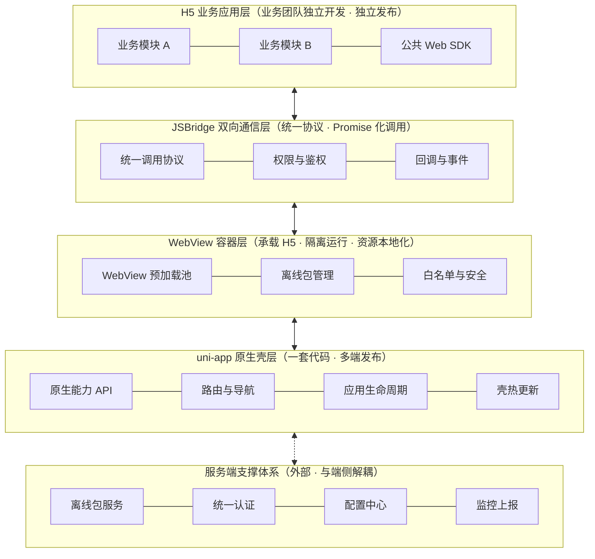
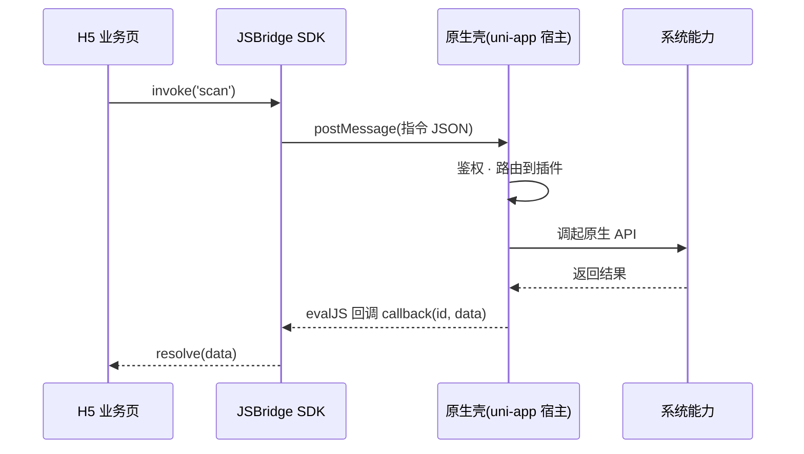

# Hydro 企业级通用 App 框架 · 架构设计方案

> **项目命名：Hydro** — 取自 "Hydrogen"（氢，最轻的元素），寓意 WebView 壳的轻量。
>
> **架构形态：** uni-app 壳 + WebView 容器 + JSBridge
>
> **核心思想：** 壳管能力、容器管承载、桥管通信、业务全在 H5。

---

## 1. 背景与目标

企业内多业务线共用一个 App 门户时，面临的典型问题：

- 业务迭代频繁，原生发版依赖应用商店审核，周期长、成本高；
- 多团队并行开发，全原生方案导致协作冲突、包体积膨胀；
- 需要一套统一的登录态、安全策略、监控体系，避免各业务重复建设。

Hydro 框架的目标：**以轻量原生壳为底座，业务全部 H5 化，通过 JSBridge 打通原生能力，实现"一次登录、全域可用、业务秒级发布"。**

## 2. 设计原则

| 原则 | 说明 |
|---|---|
| 壳轻业务轻 | 原生壳只保留能力与骨架，业务逻辑 100% 在 H5，壳的更新频率降到最低 |
| 通信统一 | 所有 H5 ↔ 原生交互收敛到唯一的 JSBridge 协议，禁止私开通道 |
| 安全前置 | 白名单、鉴权、隔离在容器层强制执行，不依赖业务自觉 |
| 体验优先 | WebView 池化 + 离线包保证"秒开"，对标原生体验 |
| 多端一致 | 基于 uni-app，一套壳代码覆盖 iOS / Android / 小程序 |

## 3. 整体分层架构



各层职责：

| 层 | 职责 | 关键设计点 |
|---|---|---|
| H5 业务应用层 | 业务逻辑全部载体 | 微前端拆分模块，各团队独立开发、独立发布，与壳解耦 |
| JSBridge 通信层 | H5 与原生双向通信 | 统一消息协议、Promise 化 API、调用鉴权、事件总线 |
| WebView 容器层 | H5 运行环境 | WebView 池化预加载、离线包、URL 白名单与安全隔离 |
| uni-app 原生壳层 | 原生能力与 App 骨架 | 一套代码编译 iOS / Android / 小程序，插件化原生能力 |
| 服务端支撑体系 | 端侧配套后台 | 离线包版本服务、SSO 认证中心、配置下发、监控接收 |

## 4. JSBridge 设计

### 4.1 通信时序

以「调起扫码」为例：



核心闭环：**postMessage 跨界（下行） + evalJS 注入（回调）**。

### 4.2 消息协议

所有调用走统一消息格式，端到端可追踪（`id` 串联请求与回调）：

```json
// H5 → Native 请求
{
  "id": "9f2c1a",
  "ns": "device",
  "method": "scan",
  "params": { "types": ["qrCode"] },
  "ts": 1762680000000
}
// Native → H5 响应
{
  "id": "9f2c1a",
  "code": 0,
  "data": { "text": "https://..." },
  "msg": "ok"
}
```

约定：

- `code = 0` 成功；`4xx` 无权限 / 参数错误；`5xx` 原生异常；
- 前端 SDK 内部维护 `id → pending Promise` 映射表，超时自动 reject；
- 事件类 API 走事件总线：`bridge.on('appStateChange', cb)`。

### 4.3 API 命名空间与权限分级

| 命名空间 | 能力 | 权限级 |
|---|---|---|
| `ui` | toast、导航、标题栏、弹窗 | public |
| `device` | 扫码、定位、蓝牙、剪贴板 | protected（动态授权） |
| `app` | 版本信息、热更新、重启 | protected |
| `auth` | 取 token、登录态刷新 | private（仅白名单域名） |
| `pay` / `media` | 支付、拍照录像 | private（二次确认） |

前端调用形态：

```ts
// 返回 Promise，内部生成唯一 id 并挂起
const result = await bridge.device.scan({ types: ['qrCode'] })
```

### 4.4 通道实现要点

> **重要：** uni-app 自带的 `web-view` 组件通信能力很弱（仅特定时机 `postMessage`），企业级方案必须**写 uni-app 原生插件补齐双向通道**。

| 通道 | 平台 | 实现 |
|---|---|---|
| H5 → Native | Android | `addJavascriptInterface` / `WebMessagePort` |
| H5 → Native | iOS | `WKScriptMessageHandler` |
| Native → H5 | 双端 | 统一封装 `evalJS`，注入执行 `window.__bridgeCallback__(id, data)` |

## 5. 核心机制设计

### 5.1 WebView 池化预加载

- App 启动时后台预热 2~3 个 WebView 实例（已注入 bridge-sdk、已同步 Cookie/UA）；
- 进入业务页时直接复用，首屏从「创建容器 + 加载资源」缩短为「仅加载资源」；
- 冷启动可省 300~800ms。

### 5.2 离线包机制（性能核心）

- **构建：** H5 构建产物打 zip，记录 hash 清单，上传离线包服务；
- **下发：** App 启动 / 进前台时检查版本，bsdiff 差量下载，CRC + 签名校验后落盘，旧版本保留用于回滚；
- **拦截：** WebView 资源请求经原生层拦截，命中离线包直接读本地，未命中走网络；
- **收益：** 业务发版不过应用商店审核，页面秒开且弱网可用。

### 5.3 安全体系（企业级重点）

- **导航白名单：** 容器拦截所有跳转，非白名单域名用系统浏览器打开，防止钓鱼页内嵌；
- **Bridge 鉴权：** 每次 invoke 校验当前页面域名 + 方法权限级；private API 额外要求服务端下发的短时签名；
- **传输：** 强制 HTTPS；壳内嵌证书校验防中间人；
- **隔离：** 每个业务模块独立 WebView 实例，JS 上下文互不可见；敏感信息只存 Keychain / Keystore。

### 5.4 登录态

- 壳负责登录（原生登录页 / 第三方 SDK），token 存原生安全存储；
- H5 加载前由容器注入 `bridge.auth.getToken()`，实现「一次登录、全域可用」；
- token 过期由壳统一刷新后广播事件。

### 5.5 监控闭环

| 层 | 指标 |
|---|---|
| Bridge 层 | 调用成功率、耗时分布、超时率（按 ns/method 维度） |
| 容器层 | 白屏率、页面加载耗时、WebView 崩溃 |
| H5 层 | JS 错误、PV/UV、自定义埋点 |

数据经 `bridge.util.report` 统一上报到监控平台。

## 6. 工程结构（脚手架仓库 · Monorepo）

> Hydro 以**工程脚手架**形态交付：快速创建新项目复用框架，框架修复 bug / 调整底层后通过 `hydro update` 对既有项目做受控更新。详见 [scaffold-design.md](./scaffold-design.md)。

```text
hydro/                          # 脚手架仓库（本仓库）
├── packages/
│   ├── create-hydro/           # npm create hydro 入口
│   ├── @hydro/cli/             # update / doctor / module / plugin
│   ├── bridge-sdk/            # JSBridge 前端 SDK（厚包，semver 发布）
│   ├── web-sdk/               # H5 公共 SDK（请求/埋点/UI组件）
│   ├── shared/                # 协议 TS 类型 + 常量（两端共用）
│   └── offline-packer/          # 离线包构建/签名/发布 CLI
├── templates/
│   ├── shell/                  # 壳工程模板（薄模板：骨架/容器接线/构建配置）
│   │   ├── src/pages/          # 原生页：启动页/登录/升级引导
│   │   ├── src/container/      # WebView 容器封装（池/拦截/白名单）
│   │   ├── src/bridge/         # JSBridge 原生侧（协议解析/鉴权/分发）
│   │   ├── nativeplugins/      # 原生插件（双通道通信增强）
│   │   └── src/store/          # 登录态/全局配置
│   └── portal/                 # 业务模块模板
├── codemods/                   # 破坏性变更自动迁移（jscodeshift，按版本组织）
├── services/
│   └── offline-server/         # 离线包版本/差量/签名服务
└── docs/                       # 架构与设计文档
```

由脚手架生成的业务项目（用户侧）：

```text
my-app/
├── .hydro-manifest.json        # 模板文件指纹 + 框架版本号
├── hydro.config.ts             # 壳配置：Web 入口/白名单/调试开关
├── apps/shell/                 # 薄壳（模板下发，可被 hydro update 管理）
├── portals/order/              # 业务代码（用户所有，更新时永不触碰）
└── package.json                # @hydro/* 依赖（与 manifest 版本对齐）
```

> `packages/shared` 让协议类型在壳与 SDK 两端共享，编译期即可发现协议不兼容——这是避免「两端各改各」的关键。

## 7. 技术选型建议

| 领域 | 选型 | 理由 |
|---|---|---|
| 壳工程 | uni-app（Vue3 + Vite） | 一套代码覆盖 iOS/Android/小程序 |
| WebView 内核 | iOS WKWebView / Android X5 或系统 WebView | X5 兼容老旧机型内核碎片化 |
| 通信通道 | 原生插件：postMessage 下行 + evalJS 回调 | 补齐 uni-app web-view 的通信短板 |
| H5 技术栈 | Vue3 + Vite + 微前端（按需 qiankun/wujie） | 与壳技术栈统一，降低心智成本 |
| 离线包 | 自研（bsdiff + 签名校验） | 可控性强；也可评估 mPaaS Neuron |
| 监控 | Sentry + 自建 Bridge 埋点 | 社区成熟 + 定制链路数据 |

## 8. 落地演进路线

| 阶段 | 目标 | 内容 |
|---|---|---|
| 一期 MVP | 跑通骨架 | 壳 + 容器 + bridge 基础 API（ui/auth/device 核心几个），单业务试点 |
| 二期 容器化 | 性能与安全 | WebView 池化、离线包全量接入、白名单与鉴权体系 |
| 三期 平台化 | 规模化 | 监控大盘、配置中心灰度、CLI 脚手架对外开放，业务团队自助接入 |

## 9. 后续待细化项

- [ ] JSBridge 协议的 TS 类型定义与两端实现骨架
- [ ] 离线包差量更新服务详细设计
- [ ] uni-app 原生插件（双通道通信）代码结构
- [ ] 白名单与签名鉴权的服务端下发协议
- [ ] 监控上报数据结构与大盘设计
