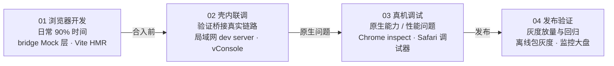

# Hydro 开发与调试指南

> 配套文档：[architecture.md](./architecture.md)（整体架构设计方案）
>
> 核心思路：**分层解耦的架构让开发调试也分层**——H5 在浏览器里开发、壳在 HBuilderX、原生插件在 Xcode / Android Studio，各层互不阻塞。同一套业务代码，三种运行环境（浏览器 Mock / 壳内联调 / 真机），按阶段递进验证。

---

## 1. 四阶段工作流总览



| 阶段 | 频率 | 验证目标 | 核心工具 |
|---|---|---|---|
| 01 浏览器开发 | 日常 90% 时间 | 业务逻辑、UI、交互 | MockBridge + Vite HMR |
| 02 壳内联调 | 每日 / 合入前 | 桥接真实链路、容器行为 | 局域网 dev server + vConsole |
| 03 真机调试 | 按需 | 原生能力、性能、兼容性 | Chrome inspect / Safari / AS / Xcode |
| 04 发布验证 | 每次发布 | 线上稳定性 | 离线包灰度 + 监控大盘 |

## 2. 阶段 01 · 浏览器开发（日常主战场）

核心是 **bridge-sdk 提供双实现 + 环境自适应**，业务代码一行不改就能在浏览器跑：

```ts
// packages/bridge-sdk/src/index.ts
const env = detectEnv() // 壳内注入的 window.__HYDRO_BRIDGE__ 存在 → real
export const bridge = env === 'shell'
  ? new RealBridge()   // postMessage + evalJS 回调
  : new MockBridge()   // 本地 mock 数据 + 模拟延迟

// 业务代码不感知环境
const { text } = await bridge.device.scan({ types: ['qrCode'] })
```

MockBridge 设计要点：

- mock 数据放 `fixtures/` 目录，返回值类型对齐 `packages/shared` 的协议类型，**编译期即可发现协议漂移**；
- 内置约 300ms 模拟延迟 + 可注入异常（失败率、超时、错误码），让 loading 态与失败分支在浏览器里就能调；
- 登录态、剪贴板等用 `localStorage` 模拟持久化；
- Mock 数据支持热替换，改 mock 不用重启 dev server。

此阶段 Vite HMR 秒级热更，不碰壳、不碰原生，效率与纯 Web 开发完全一致。

## 3. 阶段 02 · 壳内联调（每日 / 合入前）

把壳的容器页 URL 指向开发机的局域网地址，验证真实桥接链路：

```ts
// 壳工程 debug 构建下的容器配置
const WEB_ENTRY = __DEV__
  ? 'http://192.168.x.x:5173/'   // 开发机 H5 dev server
  : 'https://cdn.example.com/'   // 生产离线包 / CDN
```

关键配置（仅 debug 构建生效）：

- **放行 http 与任意 host**——白名单校验在 debug build 下跳过，但要在日志里告警提醒，避免带病上线；
- **vConsole 统一注入**：由容器在 debug 构建下注入（而不是业务 H5 自己引），保证所有业务页都有且版本一致；
- **双端日志对齐**：每次 invoke 原生侧打 `[BRIDGE] req id=xx ns.method`，H5 侧 SDK 打 `[BRIDGE] res id=xx code=0 cost=42ms`，用 `id` 串联两端日志，桥接问题一眼定位。

## 4. 阶段 03 · 真机调试

| 场景 | 工具链 |
|---|---|
| Android WebView 内 H5 | Chrome 打开 `chrome://inspect`，远程断点 / Network / Storage 全可用 |
| iOS WKWebView 内 H5 | Safari → 开发菜单 → 选设备（需 debug 构建开启 WKWebView 检查器） |
| uni-app 壳工程 | HBuilderX 真机运行 / 自定义基座 |
| 原生插件（双通道通信） | Android Studio / Xcode 直接 attach 断点 |
| 网络层 | Charles / Proxyman 抓包，配合屏蔽 SSL pinning |

注意事项：

- **正式包不可远程调试**（App Store / 应用市场构建的 WebView 检查器已关闭），因此原生插件层要自带日志开关（如"关于页连点版本号 7 次"开启 debug 日志导出），用于线上疑难问题；
- 原生插件改动后需要重新打自定义基座，建议把双通道通信插件做稳定后再进入业务密集开发期，减少基座更新频次。

## 5. 阶段 04 · 发布验证

- 离线包灰度：版本服务按内部白名单 → 1% → 全量放量；
- 观察监控大盘 48 小时：bridge 调用成功率、白屏率、页面耗时；
- 异常自动回滚旧版本包（离线包服务保留最近 N 个版本）。

## 6. 调试工具矩阵（按问题层查）

| 问题层 | 首选手段 |
|---|---|
| H5 页面逻辑 | 浏览器 DevTools（Mock 环境）/ chrome inspect（真机） |
| 桥接协议问题 | 双端对齐日志 + vConsole 的 bridge 面板 |
| 原生能力崩溃 | Xcode / Android Studio 断点 + 符号表 |
| 性能问题 | DevTools Performance 面板 + 真机监控数据 |
| 网络请求 | Charles / Proxyman + DevTools Network |

## 7. 实践建议：bridge-sdk 内置调试面板

在 vConsole 里挂一个自定义 tab，展示环形缓冲的最近 N 次调用，点击可展开完整请求与响应报文：

```text
┌─ Bridge 面板（vConsole 自定义 tab）────────────────┐
│ id=9f2c1a  device.scan    42ms  code=0           │
│ id=8a3b0e  auth.getToken   8ms  code=0           │
│ id=7d2f9c  pay.invoke     302ms code=403 ✗        │
└──────────────────────────────────────────────────┘
```

桥接是这套架构最高频的故障点，这个面板投入产出比极高——绝大多数「invoke 石沉大海」问题（白名单拦截、鉴权失败、原生插件未注册、超时）都能在面板里直接看出卡在哪一环。

排查路径参考：

```text
invoke 无响应
 ├─ H5 侧有 req 日志、原生无 → 通道断：插件未注册 / 通道封装 bug
 ├─ 原生有 req、无 res      → 鉴权拦截（看原生日志）或原生 API 崩溃
 ├─ 原生有 res、H5 未收到   → evalJS 注入失败：页面跳转 / JS 报错吞掉回调
 └─ 两端都有但业务异常      → 协议字段不一致，查 packages/shared 类型
```

## 8. 环境判定约定

| 运行环境 | 判定方式 | bridge 实现 |
|---|---|---|
| 纯浏览器（开发） | `window.__HYDRO_BRIDGE__` 不存在 | MockBridge |
| 壳内（联调 / 生产） | `window.__HYDRO_BRIDGE__` 存在 | RealBridge |
| 小程序等其他容器 | UA / uni-app 条件编译 | 降级实现或 Toast 提示 |
