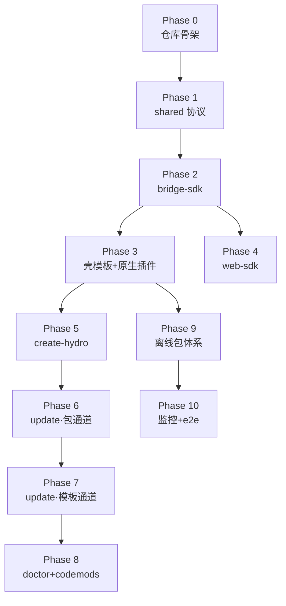

# Hydro 分阶段开发计划（AI Agent 执行版）

> 本文档是**唯一执行入口**。设计依据：[architecture.md](./architecture.md)（整体架构）、[scaffold-design.md](./scaffold-design.md)（脚手架设计）、[development-guide.md](./development-guide.md)（开发调试约定）。
>
> 执行对象：AI Agent（逐阶段串行执行，除非标注「可并行」）。

---

## 0. Agent 执行规则（每阶段开工前重读）

1. **顺序执行**：按 Phase 0 → 10 顺序推进；每个阶段完成全部验收项后，才能进入下一阶段。
2. **小步提交**：每完成一个任务即 `git commit`，遵循 Conventional Commits（`feat:` / `fix:` / `chore:` / `docs:` / `refactor:` / `test:`），一次提交只做一件事。
3. **不越界**：
   - 不引入设计文档未出现的依赖；确需新增，先在响应中说明理由并等待确认；
   - 不修改 `docs/` 已定稿设计；认为设计有问题时，停下来提出修订建议，不要直接改；
   - 不修改用户业务代码（`portals/`、生成项目的业务文件）。
4. **验收优先**：每个任务有明确交付路径；每个阶段有验收命令，**命令必须实际执行并通过**，不允许跳过或声称通过。
5. **遇阻即停**：遇到需要人工操作（原生调试、真机、账号、证书）或语义不明确时，输出当前状态与需要的信息，等待人工输入，不要猜测。
6. **进度标记**：完成任务后把本文档中对应 `- [ ]` 改为 `- [x]` 并提交（`docs: mark phase N tasks done`）。

**环境要求**：Node ≥ 20、pnpm ≥ 9、TypeScript 5.x strict、Vitest、HBuilderX（Phase 3 起，人工配合）、Xcode / Android Studio（Phase 3 起，人工配合）。

**全局技术约定**：

| 项 | 约定 |
|---|---|
| Monorepo | pnpm workspace（`packages/*` 为包；`templates/` 不是 workspace 成员） |
| 包命名 | 私有能力包 `@hydro/*`；创建入口 `create-hydro` |
| 语言 | 全仓 TypeScript strict |
| 壳 / H5 | uni-app（Vue3 + Vite）/ Vue3 + Vite |
| 测试 | Vitest（包内 `*.test.ts` 与源码同目录） |
| Lint | ESLint + Prettier（根配置统一） |

## 1. 阶段依赖图与里程碑

| Phase | 内容 | 主要交付 | 人工参与点 |
|---|---|---|---|
| 0 | Monorepo 骨架 | workspace + CI | 无 |
| 1 | 协议类型基座 | `@hydro/shared` | 无 |
| 2 | 桥接 SDK（Mock/Real） | `@hydro/bridge-sdk` | 无 |
| 3 | 壳模板 + 双通道原生插件 | `templates/shell` | HBuilderX 打基座、真机调试 |
| 4 | H5 公共 SDK | `@hydro/web-sdk` | 无 |
| 5 | 创建命令 | `create-hydro` | 无 |
| 6 | 更新·包通道 | `@hydro/cli` update 依赖升级 | 无 |
| 7 | 更新·模板通道 | manifest hash 对比 | 无 |
| 8 | doctor + codemods | 体检与自动迁移 | 无 |
| 9 | 离线包体系 | packer + server + 拦截 | 真机验证差量更新 |
| 10 | 监控 + e2e | 上报链路 + 端到端 demo | 真机回归 |

---

## Phase 0 · 仓库骨架

**目标**：可安装、可 Lint、可跑空测试的 pnpm Monorepo。

**任务**

- [x] `pnpm init` + 根 `package.json`（`private: true`，scripts：`lint` / `test` / `build`）
- [x] `pnpm-workspace.yaml`（仅含 `packages/*`）
- [x] 根 `tsconfig.base.json`（strict、`moduleResolution: bundler`、`types: ["vite/client"]`）
- [x] ESLint + Prettier 根配置（flat config）、`.editorconfig`、`.gitignore`
- [x] 目录占位：`packages/`、`templates/shell/`、`templates/portal/`、`codemods/`、`services/`、`docs/`
- [x] CI：`.github/workflows/ci.yml`（install → lint → test，Node 20）
- [x] 初始提交：`chore: init monorepo skeleton`

**验收**

- `pnpm install` 零报错
- `pnpm lint` 通过（空规则集）
- `pnpm test` 通过（占位测试）
- `git log --oneline` 至少 1 条符合规范的提交

## Phase 1 · 协议基座 `packages/shared`

**目标**：协议类型成为全仓唯一事实源（两端共享，编译期防漂移）。

**任务**

- [ ] `packages/shared/package.json`（name `@hydro/shared`）
- [ ] 消息协议类型 `src/protocol.ts`：`BridgeRequest`（id/ns/method/params/ts）、`BridgeResponse`（id/code/data/msg）、`ErrorCode` 枚举（0 成功、401/403 鉴权、404 未注册、409 参数、500 原生异常、504 超时）
- [ ] API 注册表 `src/api-registry.ts`：命名空间 `ui / device / app / auth / pay / media / util`，每个方法标注权限级 `public / protected / private`
- [ ] 事件契约 `src/events.ts`：`appStateChange`、`tokenRefreshed`、`offlinePackageUpdated`
- [ ] 版本常量 `src/version.ts`：`PROTOCOL_VERSION`（ Breaking 时 +1 ）
- [ ] 运行时校验 `src/guard.ts`：`isBridgeRequest()` 类型守卫
- [ ] 同目录单测：协议类型守卫、注册表完整性（每个 ns 至少 1 方法、权限级合法）
- [ ] 提交：`feat(shared): bridge protocol types and api registry`

**验收**

- `pnpm -F @hydro/shared test` 通过
- `pnpm -F @hydro/shared exec tsc --noEmit` 通过
- `api-registry.ts` 中存在 `device.scan`、`auth.getToken`、`util.report`（后续阶段引用）

## Phase 2 · 桥接 SDK `packages/bridge-sdk`

**目标**：业务可用的双实现桥（浏览器全 Mock、壳内全真实），含调试面板与日志。

**任务**

- [ ] `packages/bridge-sdk/package.json`（依赖 `@hydro/shared`，`exports` 双入口 browser/node）
- [ ] 环境探测 `src/detect-env.ts`：`window.__HYDRO_BRIDGE__` 存在 → `shell`，否则 `browser`
- [ ] `src/real-bridge.ts`：postMessage 下行、`window.__bridgeCallback__` 回调上行、`id → pending Promise` 映射、默认 15s 超时 reject
- [ ] `src/mock-bridge.ts`：fixtures 目录数据、默认 300ms 模拟延迟、可注入失败率/错误码/超时
- [ ] 统一入口 `src/index.ts`：按环境导出实例 + 类型（从 `@hydro/shared` re-export）
- [ ] 日志环形缓冲 `src/logger.ts`：最近 200 条 `{ id, ns.method, cost, code }`
- [ ] vConsole 自定义 tab `src/panel.ts`：展示环形缓冲，可展开完整报文
- [ ] 单测：invoke 成功/超时/Mock 异常注入/事件总线 `on/off/emit`
- [ ] 提交：`feat(bridge-sdk): dual-impl bridge with mock, timeout and debug panel`

**验收**

- `pnpm -F @hydro/bridge-sdk test` 通过，覆盖率 ≥ 80%
- 在 vitest 环境实例化 `bridge`：`await bridge.device.scan()` 走 MockBridge 且返回 fixtures 数据

## Phase 3 · 壳模板 `templates/shell`（含原生插件）

**目标**：可真机运行的薄壳：容器、白名单、桥原生侧、双通道原生插件、登录态。

**任务**

- [ ] uni-app（Vue3 + Vite）工程骨架：`src/pages/`（启动页、登录页、容器宿主页 `pages/webview/index.vue`）
- [ ] 容器封装 `src/container/`：
  - [ ] `webview-pool.ts`：预热 2 个实例的池（borrow/return）
  - [ ] `whitelist.ts`：URL 域名校验，非白名单跳系统浏览器；debug 构建放行并打告警日志
  - [ ] `debug-bridge.ts`：debug 构建注入 vConsole
- [ ] 桥原生侧 `src/bridge/`：`protocol-parser.ts`（复用 `@hydro/shared` 守卫）、`auth.ts`（域名+权限级校验）、`dispatcher.ts`（按 ns 路由到插件）
- [ ] 原生插件 `nativeplugins/HydroBridge/`：
  - [ ] Android：`addJavascriptInterface` 暴露 `__HYDRO_BRIDGE__.post()`，`evaluateJavascript` 实现回调注入
  - [ ] iOS：`WKScriptMessageHandler` + `evaluateJavaScript` 回调
  - [ ] 插件 JS 侧胶水：向 WebView 注入 `window.__HYDRO_BRIDGE__` 与 `window.__bridgeCallback__`
- [ ] 登录态 `src/store/auth.ts`：token 存原生安全存储（plus.storage / Keychain 封装）
- [ ] 模板配置 `hydro.config.ts`（Web 入口 / 白名单 / 调试开关）+ `template.json`（模板元信息与变量声明）
- [ ] 提交：`feat(shell-template): container, native bridge and dual-channel plugin`

**人工参与点（执行到此暂停，请求人工）**：HBuilderX 生成自定义基座并打原生插件；真机 / 模拟器联调。

**验收**

- 真机运行：壳加载开发机 `http://<LAN-IP>:5173/` 的 H5
- 真机 H5 控制台执行 `await window.hydro.device.scan()` 返回扫码结果（走完整真实链路）
- 关闭调试开关后访问非白名单 URL 被拦截跳系统浏览器

## Phase 4 · H5 公共 SDK `packages/web-sdk`

> 可与 Phase 3 并行（仅依赖 Phase 2）。

**任务**

- [ ] `src/request.ts`：fetch 封装，自动经 `bridge.auth.getToken()` 注入 token，401 触发刷新广播
- [ ] `src/reporter.ts`：埋点上报统一走 `bridge.util.report()`，批量缓冲 + 退出 flush
- [ ] `src/ui/`：Toast、Loading、NavBar 轻组件（Vue3，无重依赖）
- [ ] `src/vconsole.ts`：按 URL 参数 `?vconsole=1` 或 debug 环境启用
- [ ] 单测：request token 注入、reporter 缓冲 flush
- [ ] 提交：`feat(web-sdk): request, reporter and ui kit`

**验收**

- `pnpm -F @hydro/web-sdk test` 通过
- vitest 中 mock bridge 验证 401 → 刷新 → 重放请求链路

## Phase 5 · 创建命令 `packages/create-hydro`

**目标**：`npm create hydro my-app` 产出可跑项目。

**任务**

- [ ] 交互式初始化（prompts）：项目名、模板（shell 完整 / 最小）、包管理器
- [ ] 模板渲染：`templates/**` 复制 + 变量替换（项目名等，声明在 `template.json`）
- [ ] 生成 `.hydro-manifest.json`：`{ frameworkVersion, files: [{ path, hash }] }`（hash 为模板文件 sha256）
- [ ] 生成 `hydro.config.ts` 默认值、安装依赖、输出后续步骤提示
- [ ] `bin` 字段 + `npm create hydro` 本地联调（`node packages/create-hydro/bin/index.js`）
- [ ] 提交：`feat(create-hydro): scaffold projects from templates with manifest`

**验收**

- 本地执行创建 `my-app`：目录结构与 scaffold-design.md 第 6 节一致
- `my-app` 内 `pnpm dev` 启动，浏览器打开业务页，`bridge` 为 MockBridge 且 `device.scan` 返回 mock 数据
- `.hydro-manifest.json` 存在且 files 数量 = 模板下发文件数量

## Phase 6 · 更新·包通道 `packages/cli`

**目标**：`hydro update` 完成依赖升级 + changelog 展示（模板通道 Phase 7）。

**任务**

- [ ] `@hydro/cli` 包骨架（commander 或无依赖手写解析，保持薄）
- [ ] `hydro update`：读 `.hydro-manifest.json` 版本 → 查 npm 最新 `@hydro/*` → 升级 package.json → 安装
- [ ] `--to <version>` / `--dry-run` 参数
- [ ] `changes.json` 规范（随模板版本发布）：`{ version, files: [...], breaking: [...] }`，update 时渲染为人类可读报告
- [ ] git 工作区干净检测，脏则拒绝执行并提示
- [ ] 每步自动 commit：`chore(hydro): update deps to x.y.z`
- [ ] 单测（用临时目录 fixtures 模拟项目）：升级 minor / dry-run 不改文件 / 脏工作区拒绝
- [ ] 提交：`feat(cli): hydro update dependency channel`

**验收**

- fixture 项目：bump bridge-sdk 测试版本后 `hydro update`，依赖升级 + 出现自动 commit
- `hydro update --dry-run` 后 `git status` 干净

## Phase 7 · 更新·模板通道

**目标**：模板文件按所有权分级更新。

**任务**

- [ ] manifest hash 对比器：本地文件 vs 旧模板 hash vs 新模板 hash，分类 未改/已改/自有
- [ ] 未改 → 覆盖并更新 manifest；已改 → v1 输出冲突清单（文件路径 + diff 保存到 `.hydro-conflicts/`）待人工处理；**三方合并（node-diff3）作为可选增强**，`--merge` 开启
- [ ] 更新完成输出迁移报告：覆盖数 / 冲突数 / 跳过数
- [ ] manifest 版本号与 package.json 依赖同步对齐（防混搭）
- [ ] 单测：三种文件状态分类、冲突清单生成、manifest 重写
- [ ] 提交：`feat(cli): template channel with ownership classification`

**验收**

- fixture：未改文件被覆盖、被改文件进冲突清单、自有文件未被触碰（以内容断言）
- `hydro update` 全流程后 `hydro doctor`（Phase 8 前可手动检查）版本一致

## Phase 8 · doctor + codemods

**任务**

- [ ] `hydro doctor`：Node 版本 / 依赖版本对齐 / manifest 与 package.json 一致 / 原生插件注册（读模板接线配置）/ 协议版本兼容（shared `PROTOCOL_VERSION`）
- [ ] codemod runner：按版本顺序执行 `codemods/<version>/*.ts`（jscodeshift），`--yes` 才允许触碰业务文件，产出修改报告
- [ ] 示例 codemod：`codemods/0.1.0/demo-rename.ts`（演示 API 重命名迁移）
- [ ] 单测 + 提交：`feat(cli): doctor and codemod runner`

**验收**

- 健康 fixture：doctor 全绿；人为制造版本不匹配：doctor 报具体错误与修复建议
- 示例 codemod 在 fixture 上运行后调用点被正确改写

## Phase 9 · 离线包体系

**目标**：H5 发版不过审，资源本地化 + 差量更新。

**任务**

- [ ] `packages/offline-packer`：构建产物打 zip、生成 hash 清单（manifest.json）、版本元信息、`pack` / `diff` / `publish` 命令（差量用 bsdiff 的 wasm/js 实现，如 `bsdiff-node`；不可用则 v1 全量包 + 差量 TODO）
- [ ] `services/offline-server`：Node 服务（MVP 可内存 + 文件存储）——`POST /packages`（上传，验签）、`GET /latest?app=&channel=`（版本查询）、`GET /download/:version`（含差量 `?from=`）、签名下发
- [ ] 壳侧拦截：容器 `shouldOverrideUrlLoading` / 自定义协议拦截 → 命中离线包读本地，未命中走网络；下载校验 CRC + 签名后落盘，保留旧版本可回滚
- [ ] 提交：`feat(offline): packer, server and container interception`

**人工参与点**：真机验证差量更新。

**验收**

- 本地起 server：packer 发布 v1 → 壳加载；改 H5 一行 → 发布 v2（差量）→ 壳真机拉差量合并 → 页面更新生效，无白屏
- 断网后杀进程重启：页面仍可从离线包打开

## Phase 10 · 监控 + e2e 收尾

**任务**

- [ ] `bridge.util.report` 打通：bridge-sdk 采集调用成功率/耗时 → `web-sdk/reporter` 缓冲 → 服务端 `/metrics` 接收（offline-server 挂载简单聚合接口）
- [ ] 壳侧监控：白屏检测（load 超时截图判定交人工）、WebView 崩溃捕获（原生插件 onRenderProcessGone / crash 回调）
- [ ] e2e demo（`templates/portal` 完整示例）：登录（原生页）→ 进 H5 业务 → 扫码（桥）→ 弱网离线包兜底 → 升级提示
- [ ] 文档收尾：README（快速开始）、`docs/` 交叉链接检查
- [ ] 提交：`feat(monitoring): report pipeline and e2e demo`

**验收**

- 真机跑通 e2e demo 全链路，`/metrics` 收到对应埋点
- `npm create hydro` 新建项目按 README 步骤 30 分钟内跑通 demo

---

## 附：完成定义（DoD，全局）

- 所有验收命令实际执行通过，证据（输出）保留在阶段提交信息或测试报告中；
- `pnpm lint && pnpm test` 全仓绿；
- 每阶段结束更新本文档任务勾选并单独提交；
- 涉及人工参与的验收未完成时，该阶段保持「待人工验证」状态，不视为完成。

## 附：风险与预案

| 风险 | 影响 | 预案 |
|---|---|---|
| uni-app web-view 通信限制比预期严格 | Phase 3 阻塞 | 已预案：原生插件双通道；若插件调试受阻，先以 `plus.postMessage`（App 侧）降级跑通，原生插件单独立项 |
| 三方合并质量不稳 | Phase 7 返工 | v1 只出冲突清单，合并作 `--merge` 增强 |
| bsdiff 依赖不可用 | Phase 9 | v1 全量包 + hash 去重，差量后补 |
| 原生插件需频繁重打基座 | Phase 3+ 效率 | 通道插件先行稳定，业务期冻结基座 |
