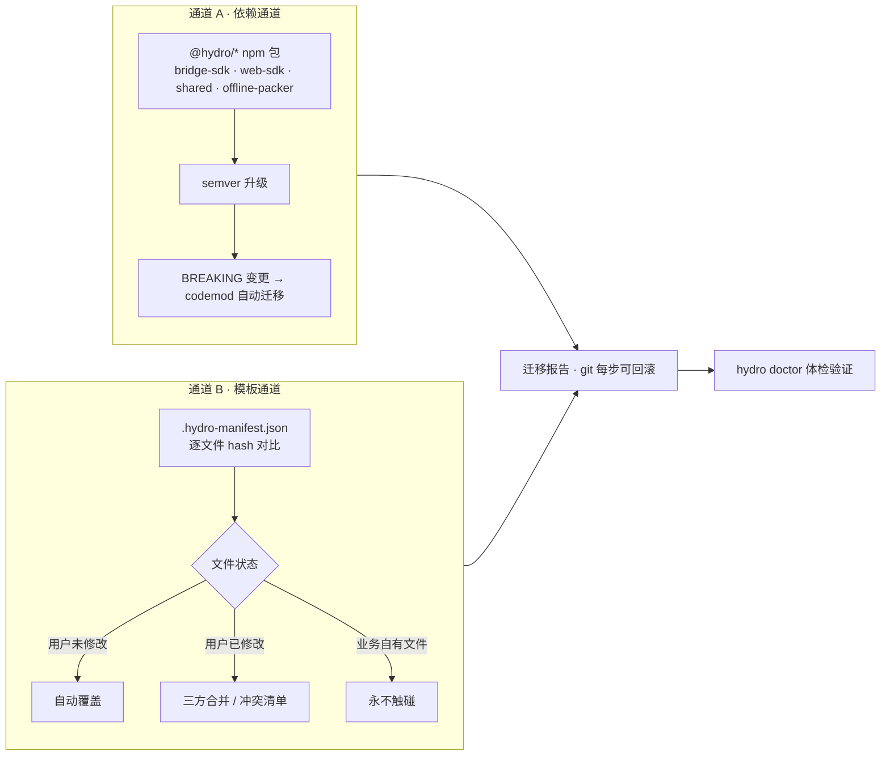

# Hydro 脚手架化设计方案

> 配套文档：[architecture.md](./architecture.md)（整体架构） · [development-guide.md](./development-guide.md)（开发与调试）
>
> 目标：Hydro 不只是一个框架，而是一个**工程脚手架**——既能快速创建新项目复用框架，也能在修复 bug、调整底层方案后，对既有项目做**受控更新**。

---

## 1. 背景与目标

框架代码会在多个业务项目中落地，随之而来两个诉求：

- **快速起项目**：新业务团队 `npm create hydro` 几分钟获得一个带完整框架能力的壳工程；
- **受控升级**：框架修了 bug、调整了底层实现（如升级通信通道、改离线包策略），各业务项目能低成本、可回滚地同步这些变更。

创建是简单的，**更新才是脚手架的难点**——核心解法是「双通道更新模型 + 文件所有权分级」。

## 2. 设计核心：薄模板、厚包

更新是否「方便」，取决于框架代码有多少落在可版本化的 npm 包里：

- **能力尽量下沉到包**（bridge-sdk、web-sdk、shared、offline-packer）——升级即改版本号，天然可靠；
- **模板只保留胶水**——壳工程骨架、容器接线、构建配置。模板越薄，需要「合并」的面积越小。

| 形态 | 内容 | 更新方式 |
|---|---|---|
| 厚包（packages） | 框架全部能力实现 | semver + codemod |
| 薄模板（templates） | 骨架、接线、配置 | manifest hash 对比 + 分级处理 |

## 3. 双通道更新模型

`hydro update` 同时走两条通道，汇合到统一的安全网：



## 4. 文件所有权模型

创建项目时脚手架写入 `.hydro-manifest.json`，记录每个模板下发文件的路径 + 内容 hash。更新时逐文件对比，按所有权分级处理：

| 文件状态 | 判定 | 策略 |
|---|---|---|
| 用户未修改 | hash 与旧模板一致 | 新模板直接覆盖，零成本 |
| 用户已修改 | hash 与旧模板不一致 | 三方合并（本地 / 旧模板 / 新模板），无法自动合并的进冲突清单，人工确认 |
| 业务自有文件 | 不在 manifest 中 | **永不触碰**，脚手架只管理自己下发的文件 |

这保证了「修 bug 调底层」时，用户项目里被定制过的框架文件不会被静默冲掉。

## 5. CLI 命令设计

```bash
npm create hydro@latest my-app   # 创建：选模板（壳工程/业务模块）、交互式配置、写入 manifest

hydro update                     # 更新：双通道执行
hydro update --to 2.3.0          # 升/降到指定版本
hydro update --dry-run           # 只出迁移报告，不改文件

hydro doctor                     # 体检：Node/壳工程/原生插件/协议版本一致性
hydro module add order           # 添加一个业务模块（portal）
hydro plugin add scan            # 添加原生能力插件并自动接线
```

## 6. 仓库结构

### 脚手架仓库（Hydro 本仓库）

```text
hydro/
├── packages/
│   ├── create-hydro/           # npm create hydro 入口
│   ├── @hydro/cli/             # update / doctor / module / plugin
│   ├── bridge-sdk/             # 框架能力包（厚包）
│   ├── web-sdk/                # H5 公共 SDK（请求/埋点/UI 组件）
│   ├── shared/                 # 协议 TS 类型 + 常量（两端共用）
│   └── offline-packer/          # 离线包构建/签名/发布 CLI
├── templates/
│   ├── shell/                  # 壳工程模板（薄模板，文件登记进 manifest）
│   └── portal/                 # 业务模块模板
├── codemods/                   # 破坏性变更自动迁移（jscodeshift，按版本号组织）
│   ├── 2.0.0/
│   └── 2.1.0/
├── services/
│   └── offline-server/         # 离线包版本/差量/签名服务
└── docs/                       # 架构与设计文档
```

### 生成的项目（用户侧）

```text
my-app/
├── .hydro-manifest.json        # 模板文件指纹 + 框架版本号
├── hydro.config.ts             # 壳配置：Web 入口/白名单/调试开关
├── apps/shell/                 # 薄壳（模板下发，可被 hydro update 管理）
├── portals/order/              # 业务代码（用户所有，更新时永不触碰）
└── package.json                # @hydro/* 依赖（与 manifest 版本对齐）
```

## 7. 更新流程细节

1. **版本对齐**：模板与 packages 同 tag 发布（`hydro@2.3.0`），manifest 记录当前版本；update 时强制「模板与包同版」，避免混搭出隐性问题；
2. **changelog 驱动**：每个版本提供 `changes.json`（哪些文件改了、哪些是 BREAKING），update 按清单执行，而不是盲目 diff 全目录；
3. **codemod 处理 API 破坏性变更**：如 `bridge.device.scan()` 改签名，由 `codemods/<version>/` 里的 jscodeshift 脚本基于 AST 自动修改业务代码调用点；codemod 属于「触碰业务文件」的白名单操作，需 `--yes` 显式确认，改完出报告；
4. **安全网**：
   - update 前检测 git 工作区必须干净，否则拒绝执行；
   - 每一步自动 commit，出问题 `git revert` 即回滚；
   - 跑完 `hydro doctor` 验证协议一致性、插件注册、依赖版本。

## 8. 落地路线

| 阶段 | 内容 | 说明 |
|---|---|---|
| MVP-1 | `create` 命令 | 模板 + 交互式初始化，快速可用 |
| MVP-2 | 包通道更新 | 升级依赖 + changelog 提示，本质是 npm 升级，成本低 |
| MVP-3 | 模板通道更新 | manifest hash 对比 + 三方合并（核心难点，可先退化为「冲突清单 + 人工处理」） |
| 后续 | codemod 体系 + doctor 深度体检 | 破坏性变更自动迁移、协议漂移检测 |

> 三方合并可基于 `diff3` / `node-diff3` 实现；做不稳之前，「冲突清单 + 人工处理」已经能覆盖绝大多数升级场景。
